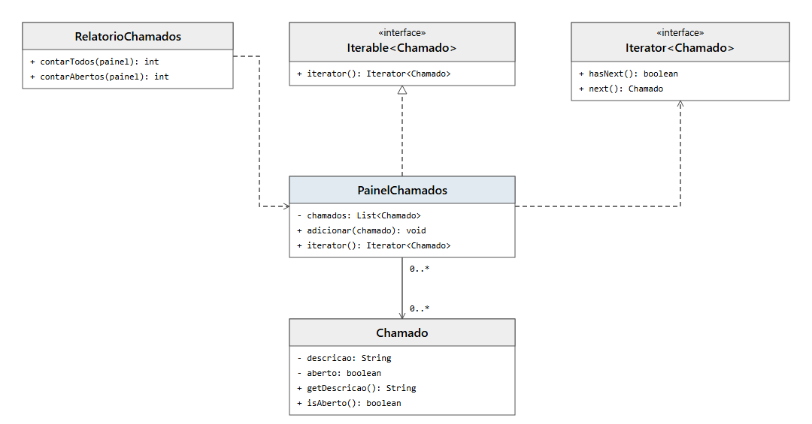

# DCC078 - Padrões de Projeto: Iterator

**Aluno:** Felipe Lazzarini Cunha

## Tema

O projeto representa um painel de chamados de suporte. O padrão Iterator permite percorrer os chamados para contar o total e os que estão abertos, sem expor a lista interna do painel.

## Diagrama de Classes UML



## Estrutura do Projeto

- `Chamado`: armazena a descrição e a situação de um chamado.
- `PainelChamados`: mantém a coleção e fornece um iterador de chamados.
- `RelatorioChamados`: percorre o painel para contar os chamados.

## Testes

Com JDK 11 ou superior e Maven:

```bash
mvn test
```
